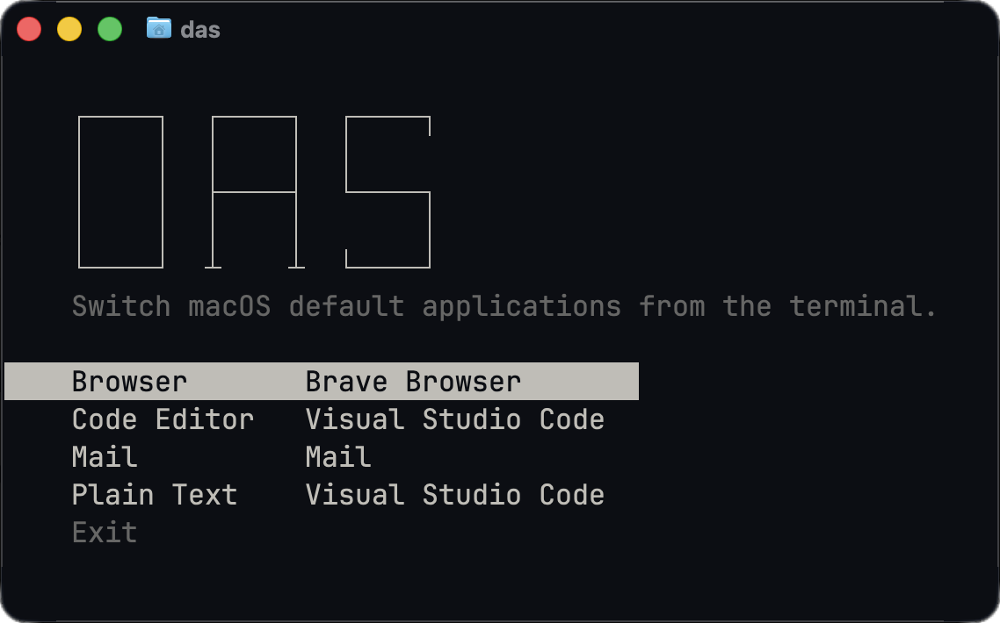

# Default App Switcher

Switch macOS default applications from the terminal.

## Preview



## Installation

### Requirements

- `macOS 14.5` or later to build and install.
- `Xcode Command Line Tools` with `Swift 6` or later.
- `Git` and `make` for building from source.

Install missing command line tools with `xcode-select --install`.

### Quick Start

The installer downloads and builds the latest published release.

Run this command in your terminal.

```bash
curl -fsSL https://raw.githubusercontent.com/itwasallcode/default-app-switcher/master/scripts/install.sh | bash
```

Open a new terminal and run `das` to choose an app; use `das --help` or `das --version` for details.

If `das` is not found, follow the installer's instructions to add `$HOME/.local/bin` to your shell's `PATH`.

Run the installation command again to update to the latest release.

To uninstall the release installation, run:

```bash
curl -fsSL https://raw.githubusercontent.com/itwasallcode/default-app-switcher/master/scripts/install.sh | bash -s -- --uninstall
```

This removes the installed files and command link; your default apps and shell configuration are preserved.

### Build From Source

This builds the repository's current default branch.

Run these commands in order and stop if one fails.

```bash
git clone https://github.com/itwasallcode/default-app-switcher.git "$HOME/.default-app-switcher"
cd "$HOME/.default-app-switcher"
make build
```

Add this line once to the startup file for your shell.

```bash
export PATH="$HOME/.default-app-switcher/dist:$PATH"
```

| Shell | Startup file |
| --- | --- |
| `zsh` | `${ZDOTDIR:-$HOME}/.zshrc` |
| Login `bash` | `~/.bash_profile`, or an existing `~/.bash_login` or `~/.profile` |
| Non-login `bash` | `~/.bashrc` |

For other shells, use their `PATH` syntax.

Open a new terminal, or reload the file you edited to update your current terminal.

For `zsh`, reload the file with `source "${ZDOTDIR:-$HOME}/.zshrc"`.

Then check the active command and run `das`.

```bash
command -v das && das --version
das
```

Keep `dist/das` and `dist/das-helper.app` together.

Moving the clone or running `make clean` makes this source installation unavailable.

When both methods are installed, `command -v das` shows which one will run.

#### Optional Update

To use newer source changes, pull them into a clean clone and rebuild.

Stop if any command fails.

```bash
cd "$HOME/.default-app-switcher"
git pull --ff-only
make build
```

#### Remove

Remove the source `PATH` line from your shell configuration, then open a new terminal.

Delete the clone if you no longer need it.
